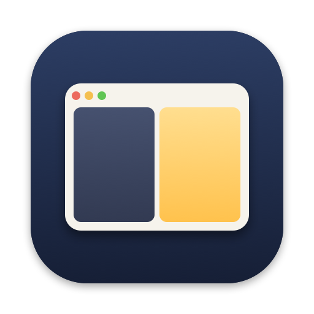

<p align="center"></p>

<h1 align="center">Shade</h1>

A menu bar app that dims individual windows on macOS — for example, the too-bright side of a split screen.

## How it works

Shade places a translucent, click-through black window directly above the target window. It polls `CGWindowList` so the overlay follows the target as it moves, resizes, or changes stacking order: 60 times per second right after mouse clicks, drags, app or Space switches, and 4 times per second when nothing is happening. The overlay hides when the window is minimized or moved to another Space, and is removed when the window closes.

No Accessibility or Screen Recording permission is required.

## Run

```bash
swift run
```

Or package it as an app (creates `build/Shade.app`, which you can drag into Applications):

```bash
./build-app.sh
open build/Shade.app
```

## Usage

1. Click the ☀ icon in the menu bar → "Pick a Window to Dim…"
2. Hover over the window you want to dim (it gets highlighted) and click it. Press Esc or right-click to cancel.
3. Click the menu bar icon again and use the slider to set the dim level (0–90%). Click ⓧ to stop dimming that window.

Shade remembers the dim level per app and reuses it the next time you pick a window from the same app.

Debug: `Shade --dim-app Finder` dims Finder's frontmost window on launch.

## Troubleshooting

Shade logs when overlays are shown, hidden, reordered and removed:

```bash
log stream --predicate 'subsystem == "com.github.tiancal.shade"' --level debug
```

## Known limitations

- Can only dim, not brighten.
- The overlay uses a fixed 16pt corner radius to approximate window corners, so some windows may show slight mismatches at the corners.
- The overlay may lag one frame behind while a window is being dragged.
- Menus and dialogs opened by the target app are not dimmed.
